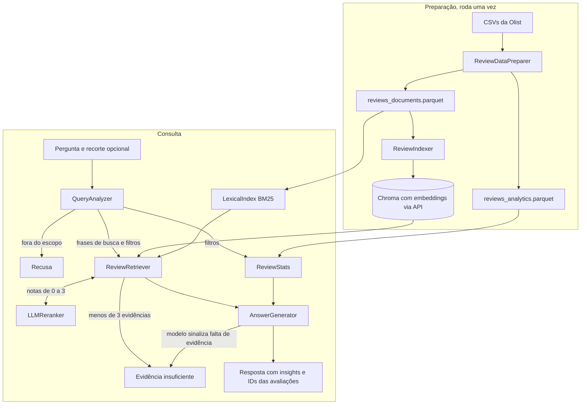

# Voz do Cliente Olist

Solução de Voice of Customer com RAG para o Tech Challenge da Fase 4. Você pergunta em linguagem natural sobre as avaliações da base Brazilian E-Commerce Public Dataset by Olist e recebe um resumo com as avaliações que o sustentam. Se a pergunta foge do tema ou a base não tem avaliações sobre o assunto, o sistema responde que não consegue afirmar nada.

## Problema de negócio

A Olist reúne 99.224 avaliações de pedidos feitos entre 2016 e 2018. A nota diz se o cliente gostou da compra. O motivo fica no comentário, e só 41% dos clientes escreveram algum. Um gestor não lê 40 mil comentários. Com este projeto, ele pergunta "o que os clientes relatam sobre atrasos?" e lê um resumo que aponta as avaliações usadas.

## Arquitetura



| Componente | Arquivo | Responsabilidade |
|---|---|---|
| `Settings` | `voc_rag/config.py` | Guarda caminhos, provedores, modelos e parâmetros de busca |
| Provedores | `voc_rag/llm.py` | Cria os modelos de chat e os embeddings da OpenAI ou do Gemini |
| `ReviewDataPreparer` | `voc_rag/preparation.py` | Lê os CSVs, limpa os textos, junta metadados e grava os parquets |
| `ReviewIndexer` | `voc_rag/indexing.py` | Gera os embeddings e cria a coleção do modelo no Chroma |
| `QueryAnalyzer` | `voc_rag/query_analyzer.py` | Checa o escopo, classifica a pergunta, escreve as frases de busca e extrai filtros |
| `LexicalIndex` | `voc_rag/lexical.py` | Busca por palavras com BM25, respeitando os filtros |
| `LLMReranker` | `voc_rag/reranker.py` | Dá a cada candidato uma nota de relevância de 0 a 3 |
| `ReviewRetriever` | `voc_rag/retriever.py` | Junta busca densa e BM25, aplica corte e rerank, divide as vagas entre as frases e agrupa repetidos |
| `ReviewStats` | `voc_rag/stats.py` | Calcula os números do recorte sobre a base completa |
| `AnswerGenerator` | `voc_rag/generator.py` | Monta o contexto, gera a resposta estruturada e valida as citações |
| `VoCPipeline` | `voc_rag/pipeline.py` | Encadeia as etapas, aplica o recorte manual, devolve as recusas e registra o rastreio |
| Avaliação | `voc_rag/evaluation.py` | Mede recuperação, recusas, filtros, fundamentação, custo e tempo |
| Esquemas | `voc_rag/schemas.py` | Define os modelos Pydantic da saída do LLM e os objetos de resultado |
| Prompts | `voc_rag/prompts.py` | Guarda as instruções dos modelos e as mensagens de recusa |
| Interface | `app.py` | Chat em Streamlit com evidências, recorte, panorama e rastreio |
| Linha de comando | `voc_rag/cli.py` | Comandos `prepare`, `index`, `ask`, `examples` e `evaluate` |

## Tecnologias

- Python 3.11 ou superior
- LangChain (`langchain`, `langchain-core`, `langchain-openai`, `langchain-google-genai` e `langchain-chroma`), com `init_chat_model` para trocar de provedor pelo `.env`
- OpenAI ou Google Gemini, sempre por API: chat, rerank, juiz da avaliação e embeddings. Não há modelo local, então a instalação não precisa de PyTorch nem de GPU
- Chroma como banco vetorial local
- `rank-bm25` para a busca lexical, em memória
- pandas e pyarrow para preparação e estatísticas
- Streamlit para a interface
- Jupyter e matplotlib para os notebooks

## Preparação da base

O comando `python -m voc_rag.cli prepare` gerou os números abaixo a partir dos arquivos do Kaggle.

| Métrica | Valor |
|---|---|
| Avaliações no arquivo | 99.224 |
| `review_id` repetidos, com a mesma avaliação ligada a mais de um pedido | 814 |
| Avaliações sem título | 88,3% |
| Avaliações sem comentário | 58,7% |
| Tamanho mediano do comentário | 53 caracteres, com máximo de 208 |
| Avaliações com texto depois da limpeza | 42.370 |
| Documentos indexados | 39.192 |

### Seleção dos dados

O projeto usa cinco arquivos. `order_reviews` traz nota, título e comentário. `orders` traz as datas de compra, entrega e prazo estimado. `order_items` e `products` informam a categoria do produto, e `customers` informa o estado do cliente.

Deixamos de fora pagamentos, vendedores e a tradução de categorias. A forma de pagamento e o vendedor não ajudam a encontrar nem a filtrar comentários, e as perguntas chegam em português, a mesma língua das categorias originais.

### Limpeza e preparação dos textos

Os modelos de embeddings foram treinados com texto natural. Se a limpeza apagar o "não" de "não recebi", a frase inverte o sentido. Por isso a limpeza mexe pouco no texto.

A função `clean_text` faz estas trocas:

- normaliza o Unicode para NFC, e cada letra acentuada passa a ter uma codificação só;
- troca quebras de linha e tabulações por espaço, um problema presente em 3.852 comentários;
- substitui e-mails, URLs, CPFs e telefones por `[email]`, `[url]`, `[cpf]` e `[telefone]`, para que dados pessoais não cheguem às APIs (LGPD);
- reduz pontuação repetida, como "!!!!!", a um caractere.

A função `compose_text` junta título e comentário e descarta o título quando ele já aparece no comentário. A limpeza mantém maiúsculas, stopwords, acentos e a forma original das palavras. A busca BM25 usa uma tokenização própria, descrita em [Pipeline RAG](#pipeline-rag).

### Tratamento de valores ausentes

| Situação | Tratamento | Motivo |
|---|---|---|
| Sem título e sem comentário | A avaliação fica na base analítica e sai do índice | A nota continua valendo nas estatísticas |
| Só título, em 1.729 avaliações | Vira documento se passar no filtro de tamanho | Títulos como "Não recebi o produto" têm conteúdo |
| Sem data de entrega | `delivery_status = nao_entregue` | O pedido que não chegou explica a insatisfação |
| Sem categoria, em 610 produtos e 759 avaliações de pedidos sem item | `category = sem_categoria` | A avaliação continua na base |
| Dias de atraso sem data de entrega | `delay_days` nulo (`Int64`) | Um valor sentinela, como -999, distorceria médias e filtros |
| `review_id` repetido | O preparador mantém uma linha | O texto e a nota se repetem iguais |

### Organização dos documentos

Cada avaliação vira um documento. O comentário mais longo tem 208 caracteres, então não precisamos dividir textos em pedaços. O ID do documento é o `review_id`, e com ele você rastreia qualquer citação até a linha do CSV.

O índice recebe textos com duas palavras ou mais e ao menos uma letra. A regra tira do índice os elogios de uma palavra, como "bom" e "ótimo", que somam 2.664 comentários na base bruta. Também tira 186 textos sem letras, como "." e "10". Textos curtos com conteúdo, como "Não recebi", entram.

Cada documento carrega os metadados `review_id`, `score`, `category`, `delivery_status`, `delay_days`, `purchase_month`, `purchase_month_num` e `state`.

A base analítica `reviews_analytics.parquet` guarda as 98.410 avaliações únicas, com ou sem texto. A base de documentos `reviews_documents.parquet` guarda as 39.192 indexáveis.

### Embeddings e indexação

O modelo padrão é o `text-embedding-3-small` da OpenAI, que tem bom desempenho em português e custa US$ 0,02 por milhão de tokens. Os 39.192 documentos somam cerca de 2,9 milhões de caracteres, e a indexação completa sai por alguns centavos de dólar. Com `EMBEDDING_PROVIDER=google`, o projeto usa o `gemini-embedding-2-preview`.

O Chroma roda local, grava em `data/chroma` e filtra por metadados. Com 39 mil documentos, um servidor vetorial dedicado só acrescentaria infraestrutura. Cada modelo de embeddings tem sua própria coleção, e a coleção usa distância de cosseno explícita, porque nem todo provedor devolve vetores com norma 1. O indexador envia lotes de 1.000 documentos e recria só a coleção do modelo atual. Ao montar o pipeline, o código confere se a coleção tem o mesmo número de documentos que o parquet.

O Chroma local não oferece busca híbrida: a API de busca com BM25 e RRF só existe no Chroma Cloud. Por isso o BM25 roda em memória, sobre o parquet de documentos, e leva poucos segundos para ser montado quando a aplicação inicia.

## Pipeline RAG

1. **Transformação da pergunta.** O `QueryAnalyzer` faz uma chamada ao LLM com saída estruturada no esquema `QueryAnalysis`. O modelo informa se a pergunta está no escopo, se ela pede um panorama ("quais os principais problemas?") ou trata de um assunto específico, escreve as frases de busca e preenche os filtros. As frases são escritas como um cliente escreveria na avaliação: de 4 a 6 em perguntas de panorama, uma por subtema provável, e 1 ou 2 em perguntas específicas. Uma pergunta abstrata sobre "problemas" fica longe, no espaço vetorial, de uma avaliação que diz "o produto não chegou"; as frases concretas encurtam essa distância. O código descarta categorias que não existem na base.
2. **Busca híbrida.** Para cada frase, o `ReviewRetriever` pede ao Chroma os 40 documentos mais próximos e ao BM25 os 40 de maior pontuação, os dois com os mesmos filtros. O BM25 encontra termos exatos, como "correios" ou "nota fiscal". A tokenização do BM25 tira acentos e stopwords e corta as palavras em 5 letras, mas mantém o "não". As duas listas são fundidas por Reciprocal Rank Fusion (RRF, k=60), que combina posições e dispensa normalizar os scores.
3. **Corte de similaridade.** O retriever lê os embeddings dos candidatos no Chroma e calcula o cosseno com a frase de busca, inclusive para os que vieram só do BM25. Candidatos abaixo de 0,40 saem.
4. **Rerank.** Até 30 candidatos por frase vão a um LLM, que lê a pergunta original, o filtro aplicado, a frase de busca e cada avaliação e dá uma nota de 0 a 3. As chamadas rodam em paralelo. Só ficam as avaliações com nota 2 ou 3. O rerank recebe a pergunta original para cobrar as condições essenciais: uma avaliação sobre entrega comum recebe nota baixa numa pergunta sobre entregas por drone.
5. **Seleção.** As vagas do contexto (12 em perguntas específicas, 20 em panorama) são divididas igualmente entre as frases com resultado, para que todos os subtemas apareçam; com 6 frases, a divisão fica em 4, 4, 3, 3, 3 e 3. Dentro da vaga de cada frase, o MMR (Maximal Marginal Relevance, λ=0,7) escolhe avaliações relevantes e diferentes entre si, o que evita quatro versões de "chegou atrasado". Várias avaliações "Não recebi o produto" viram uma evidência com contador de repetições.
6. **Panorama.** O `ReviewStats` aplica os mesmos filtros na base analítica completa e calcula total de avaliações, percentual com comentário, distribuição de notas, situação de entrega e, sem filtro de estado, os estados com mais avaliações.
7. **Construção do contexto.** Cada evidência entra no prompt com ID `R1`, `R2` e assim por diante, seguida dos metadados do pedido (nota, categoria, entrega, mês e estado), da frase de busca que a encontrou e do texto do cliente, em blocos separados.
8. **Geração.** O `AnswerGenerator` pede ao LLM uma saída `GeneratedAnswer` com resumo, insights, IDs que sustentam cada insight e limitações. Em seguida, o código valida as citações e descarta insights sem citação válida.

Cada componente pode ser desligado no `.env` (`USE_MULTI_QUERY`, `USE_BM25` e `USE_RERANK`). A avaliação compara as combinações.

## Respostas fundamentadas em evidências

Cada insight exibido cita pelo menos uma avaliação, e o `AnswerGenerator` confere as citações depois da geração. A validação aceita variações como `[R1]` e `r 1` e intervalos como `R1-R3`, remove IDs que não existem no contexto e descarta o insight que fica sem citação. Se nenhum insight sobrar, a resposta vira "evidência insuficiente".

O prompt instrui o modelo a não estimar frequências a partir da amostra recuperada nem ordenar temas por recorrência, porque as vagas são divididas por subtema: cada tema aparece com o mesmo número de evidências, tenha ele dez ou mil avaliações na base. Os números da resposta vêm do panorama, que o pandas calcula sobre a base inteira.

O contexto identifica separadamente o texto do cliente e os metadados do pedido. O gerador deve atribuir relatos apenas ao texto: um pedido classificado como atrasado pode ter um comentário que só elogia o produto. Quando usar a situação de entrega calculada, a resposta deve indicar que essa informação vem dos metadados. A avaliação mede quantos insights violam essa regra.

Na interface, a tela inicial apresenta indicadores da base e três temas para começar a exploração. A barra lateral reúne as perguntas de exemplo, o recorte da análise e a ação de iniciar uma nova conversa. Cada pergunta é analisada de forma independente.

Enquanto a análise roda, de 10 a 20 segundos, um painel abaixo da pergunta mostra a etapa atual (entender a pergunta, buscar, avaliar a relevância e escrever a análise) e o que já foi decidido: o tipo da pergunta, as frases de busca, o recorte aplicado e quantas avaliações foram encontradas e selecionadas. A barra lateral fica travada e avisa que o recorte em uso continua aplicado.

Cada resposta destaca a síntese e os principais achados com os IDs citados. As abas separam as avaliações (com similaridade, nota do rerank e a frase de busca que encontrou cada uma), o panorama do recorte e os detalhes da busca: filtros, frases, funil de cada frase, tempo e tokens. A análise pode ser baixada em Markdown, e falhas de consulta permitem tentar novamente sem perder o histórico. O tema visual fica em `.streamlit/config.toml`.

## Perguntas sem evidências suficientes

O pipeline tem quatro pontos de parada, do mais barato para o mais caro. O campo `stopped_at` do rastreio registra qual deles recusou.

| Barreira | Quando recusa | `stopped_at` |
|---|---|---|
| Escopo | O `QueryAnalyzer` conclui que a pergunta não trata da experiência de compra | `scope` |
| Recorte vazio | Nenhuma avaliação da base atende aos filtros, como um ano fora do período de 2016 a 2018 | `empty_filter` |
| Similaridade | Nenhum candidato passa do corte de cosseno | `similarity` |
| Rerank | Menos de 3 avaliações recebem nota 2 ou 3 | `rerank` |
| Gerador | O LLM marca `sufficient_evidence = false`, ou a validação elimina todos os insights | `generator` |

Com o recorte vazio, a resposta informa o filtro aplicado e o período coberto pela base, por exemplo: "Nenhuma avaliação da base atende ao recorte da pergunta (Entrega == Não entregue; Mês da compra >= 2025-01; Mês da compra <= 2025-12). A base cobre compras de 2016-09 a 2018-10." O pipeline não troca o período por conta própria, para não responder a uma pergunta diferente da feita. As barreiras de recorte vazio, similaridade e rerank recusam sem chamar o gerador, e a de recorte vazio também dispensa a busca. Se a chamada ao LLM falhar, o pipeline devolve o status `erro`, mantém as evidências já recuperadas e a interface oferece "Tentar novamente".

Os prompts tratam a pergunta e o texto das avaliações como dados. Pedidos para inventar avaliações, ignorar regras ou assumir outro papel não são obedecidos, e a avaliação inclui um caso desses.

O corte de cosseno de 0,40 funciona como pré-filtro barato, não como barreira. Na avaliação, as perguntas sem base tiveram similaridade máxima entre 0,58 e 0,73, na mesma faixa das que têm resposta, e só o rerank separou os dois grupos (nota máxima 1 contra 3). O split `dev` da avaliação registra a maior similaridade e a maior nota do rerank de cada pergunta; use-o para recalibrar quando trocar o modelo de embeddings.

## Metadados e exploração contextual

O Chroma e o BM25 aplicam os filtros antes de ordenar. Numa busca por "problemas nas avaliações com nota baixa" sem filtro, elogios com as mesmas palavras aparecem entre os resultados. Com `score <= 2`, a busca considera só avaliações negativas.

Os filtros vêm de duas fontes. O analisador extrai os da pergunta: nota, situação de entrega, categoria, período e estado do cliente. A barra lateral permite escolher um recorte manual, que tem prioridade. Quando o recorte manual troca um filtro identificado na pergunta, a resposta traz um aviso, porque o filtro pode ser a causa de uma resposta inesperada. A chave "Usar filtros de metadados" desliga os dois de uma vez.

Os filtros devem vir da pergunta original, não dos termos acrescentados na reescrita da busca. Perguntar por reclamações sobre entrega ou relatos de atraso mantém a situação de entrega sem filtro. Pedir "somente pedidos entregues com atraso" aplica `delivery_status = atrasado`. Isso preserva a diferença entre o tema do comentário e a situação registrada do pedido.

A análise exploratória sustenta a escolha de cada metadado:

| Metadado | Evidência na base |
|---|---|
| `delivery_status` | Nota 1 em 53,8% dos pedidos atrasados, em 70,9% dos não entregues e em 6,6% dos entregues no prazo |
| `purchase_month_num` | 11,9% das avaliações de compras de novembro de 2017 vêm de pedidos atrasados, contra 3,9% em outubro |
| `score` | Clientes com nota 1 comentam em 76,5% dos casos, e clientes com nota 5 em 35,9% |
| `category` | 73 categorias de produto disponíveis para filtro |
| `state` | 27 UFs; o filtro usa a UF do cliente |

Clientes com nota 1 escrevem mais, e isso distorce o índice. A nota 1 representa 11,5% da base e 22,0% dos documentos indexados. Por isso o `ReviewStats` calcula o panorama sobre as 98.410 avaliações da base analítica.

## Avaliação

O comando `python -m voc_rag.cli evaluate --judge` mede o pipeline e grava o relatório em [docs/avaliacao.md](docs/avaliacao.md) e o detalhe de cada pergunta em `data/eval/avaliacao.json`. Os casos ficam em `examples/eval_set.json`.

### O que é medido

- **Recuperação, precisão@10.** Para 8 temas (atraso, defeito, produto diferente, pedido incompleto, atendimento, devolução, embalagem e rapidez), o comando ordena as avaliações com a própria pergunta e conta quantas das 10 primeiras casam com a expressão regular do tema. Não existe gabarito anotado, então o rótulo é aproximado; ele serve para comparar as estratégias entre si. Quatro estratégias: só densa, híbrida, densa com rerank e híbrida com rerank.
- **Respostas e recusas.** São 23 perguntas: 11 que a base responde e 12 que devem ser recusadas, entre fora do escopo, sem evidência, com condição essencial impossível (Lua, drone, videochamada), período fora da base e tentativa de injeção de prompt. Elas estão divididas em dois grupos. O split `dev` (8 perguntas) serve para calibrar parâmetros, como `MIN_SIMILARITY`. O split `test` (15 perguntas) serve para relatar o resultado, sem ajuste. O relatório mostra a acurácia, as recusas indevidas, as respostas indevidas, os erros e a barreira que recusou cada pergunta.
- **Ablação.** As perguntas rodam em quatro configurações: `baseline` (uma frase de busca, busca densa e corte de similaridade), `multi_query`, `hybrid` (com BM25) e `full` (com rerank). Todas recebem a mesma análise da pergunta em cada repetição, para isolar o efeito da recuperação.
- **Extração de filtros.** Compara as condições extraídas com `expected_filters` nas perguntas que têm filtros esperados.
- **Fundamentação.** Um LLM-juiz confere cada insight contra as avaliações que ele cita (sustentado, parcial ou não sustentado) e marca quando o insight atribui ao cliente algo que só está nos metadados do pedido. O relatório também conta os insights descartados pela validação de citações.
- **Custo e tempo.** Tokens de entrada e saída e segundos por pergunta, em cada configuração.

Com `--repeat N`, as perguntas rodam N vezes e a acurácia sai com média e desvio. Defina `JUDGE_PROVIDER` e `JUDGE_MODEL` com outro provedor: um juiz da mesma família do gerador tende a favorecer as próprias respostas, e o relatório avisa quando isso acontece.

### Resultados

Os números abaixo vêm de uma execução em 3 de novembro de 2026, com `gpt-5.6-luna` no chat, no rerank e no juiz, `text-embedding-3-small` nos embeddings e uma repetição. Essa execução tinha 22 perguntas; o caso de período fora da base ("Quem comprou e não chegou em 2025?") e a barreira de recorte vazio foram incluídos depois e entram na próxima execução. O relatório completo, com o resultado de cada pergunta, está em [docs/avaliacao.md](docs/avaliacao.md).

**Recuperação, precisão@10**

| Tema | Densa | Híbrida | Densa + rerank | Híbrida + rerank |
|---|---|---|---|---|
| Atraso na entrega | 1,00 | 1,00 | 1,00 | 1,00 |
| Produto com defeito ou quebrado | 0,90 | 1,00 | 0,90 | 1,00 |
| Produto diferente do anunciado | 1,00 | 1,00 | 1,00 | 1,00 |
| Pedido incompleto | 1,00 | 1,00 | 1,00 | 1,00 |
| Atendimento e comunicação | 0,50 | 0,50 | 0,60 | 1,00 |
| Devolução ou reembolso | 0,90 | 1,00 | 0,90 | 1,00 |
| Embalagem | 0,90 | 0,60 | 0,90 | 0,90 |
| Elogio à rapidez da entrega | 0,90 | 0,70 | 0,90 | 0,90 |
| **Média** | **0,89** | **0,85** | **0,90** | **0,97** |

O BM25 sozinho piora a média, porque traz avaliações que repetem palavras da pergunta sem tratar do tema ("embalagem" e "rapidez" caem). O rerank sozinho quase não muda a ordem da busca densa. A combinação dos dois dá o melhor resultado: o BM25 amplia os candidatos, e o rerank descarta os que só coincidem nas palavras. O ganho maior aparece em "atendimento", em que a busca densa acerta metade.

**Respostas e recusas**

| Configuração | Acurácia dev (8) | Acurácia test (14) | Recusas indevidas | Respostas indevidas | Barreiras que recusaram | Tokens por pergunta (entrada/saída) | Segundos por pergunta |
|---|---|---|---|---|---|---|---|
| `baseline` | 0,88 | 1,00 | 1 | 0 | gerador: 7, escopo: 5 | 1.548 / 333 | 4,5 |
| `multi_query` | 1,00 | 1,00 | 0 | 0 | gerador: 6, escopo: 5 | 1.833 / 384 | 6,6 |
| `hybrid` | 1,00 | 1,00 | 0 | 0 | gerador: 6, escopo: 5 | 1.839 / 338 | 6,0 |
| `full` | 1,00 | 1,00 | 0 | 0 | rerank: 6, escopo: 5 | 4.098 / 2.686 | 14,0 |

Os tokens da tabela não incluem a análise da pergunta, comum a todas as configurações, com média de 1.728 de entrada e 160 de saída.

- A configuração `baseline` recusou "Quais são os principais problemas relatados pelos clientes?". Com uma frase de busca só, as evidências cobriam um tema, e o gerador concluiu que não respondiam a uma pergunta de panorama. As várias frases de busca resolveram o caso.
- O corte de cosseno de 0,40 não recusou nenhuma pergunta. A maior similaridade das perguntas sem base (drone, criptomoedas, Lua, milhas, videochamada e cashback) ficou entre 0,58 e 0,73, na mesma faixa das perguntas com resposta (de 0,71 a 0,95). A similaridade mede proximidade de assunto, e "entrega por drone" fica perto de "entrega". Sem o rerank, quem recusou essas perguntas foi o gerador, depois de receber as evidências.
- Com o rerank, a nota máxima dessas perguntas foi 1, e a das perguntas com resposta foi 3. Elas foram recusadas antes do gerador. As perguntas fora do tema e a tentativa de injeção de prompt pararam na checagem de escopo.
- O rerank mais que dobra os tokens e o tempo, porque o mesmo modelo de raciocínio do chat dá as notas. Um `RERANK_MODEL` mais barato reduz esse custo; rode a avaliação de novo para confirmar que as recusas se mantêm.

**Fundamentação, pelo juiz**

| Configuração | Insights | Sustentados | Parciais | Não sustentados | Metadado atribuído ao cliente |
|---|---|---|---|---|---|
| `baseline` | 32 | 29 | 3 | 0 | 0 |
| `multi_query` | 48 | 44 | 4 | 0 | 1 |
| `hybrid` | 50 | 43 | 7 | 0 | 1 |
| `full` | 53 | 49 | 4 | 0 | 0 |

Nenhum insight foi julgado sem sustentação, e a validação de citações não precisou descartar nenhum. A configuração `full` gera mais insights, porque cobre mais subtemas, com a maior proporção de sustentados (49 de 53). O juiz é o mesmo modelo do gerador e tende a favorecer as próprias respostas; trate esses números como indicativos.

**Extração de filtros:** 7 de 8 perguntas acertaram todas as condições. Em "Do que os clientes reclamaram nas compras de novembro de 2017?", o analisador acrescentou `score <= 2` ao filtro de mês, tratando "reclamaram" como nota baixa.

**Configuração padrão:** a ablação sustenta deixar os três componentes ligados. As várias frases de busca corrigem a recusa indevida, o BM25 com o rerank dá a melhor precisão, e o rerank é a única barreira que separa as perguntas sem base antes do gerador.

**Limites da avaliação:** 22 perguntas e uma repetição medem a direção dos efeitos, não a variação entre execuções; use `--repeat 3` para obter média e desvio. A relevância da recuperação usa expressões regulares, e o juiz é da mesma família do gerador.

## Principais decisões técnicas

| Decisão | Alternativa descartada | Motivo |
|---|---|---|
| Chroma local | Qdrant ou pgvector em servidor | 39 mil documentos cabem em disco local |
| Um documento por avaliação | Chunking | O comentário mais longo tem 208 caracteres |
| `review_id` como ID do documento | Posição da linha no parquet | O ID não muda quando a base é reconstruída |
| Modelos só por API (OpenAI ou Gemini) | Embeddings e cross-encoder locais | Sem PyTorch, a instalação fica leve e roda em qualquer máquina; o custo por pergunta fica em centavos |
| Uma chamada de LLM para escopo, tipo, frases de busca e filtros | Chamadas separadas | Menos latência e custo |
| Várias frases de busca em perguntas de panorama | Uma frase só | Cada subtema ganha sua busca e suas vagas no contexto |
| Busca híbrida, densa e BM25, com RRF | Só busca densa | O BM25 acha termos exatos que a busca densa perde |
| BM25 em memória | Busca híbrida do Chroma | A busca híbrida do Chroma só existe no Chroma Cloud |
| Rerank por LLM com nota de 0 a 3 | Cross-encoder local ou serviço de rerank dedicado | Mantém só os provedores do projeto e cobra as condições essenciais da pergunta |
| Corte de cosseno antes do rerank | Rerank de todos os candidatos | Descarta candidatos distantes sem gastar tokens |
| Cota por frase e MMR | Só os maiores scores | Um tema com frases muito diretas não ocupa todas as vagas |
| Saída estruturada com IDs | Resposta em texto livre | O código consegue validar as citações |
| Panorama calculado com pandas | Pedir frequências ao LLM | O LLM vê no máximo 20 avaliações e não tem como estimar frequências da base |
| Metadados separados do texto do cliente no contexto | Metadados e texto no mesmo bloco | Evita atribuir ao cliente um atraso que só consta nos dados do pedido |
| Status de erro com nova tentativa | Regras de reserva quando o LLM falha | As regras de reserva pulariam a checagem de escopo |
| Sem campo de "confiança" na resposta | Confiança autodeclarada pelo LLM | O número não é calibrado; as barreiras e o rastreio dizem por que a resposta saiu |
| Nota como filtro | Campo de sentimento derivado da nota | O sentimento repetiria a nota com outro nome |
| Classes com fluxo linear | LangGraph | O fluxo tem saídas antecipadas simples, e um grafo aumentaria o código |
| Avaliação com split dev e test | Calibrar e medir nas mesmas perguntas | Evita ajustar o corte às perguntas usadas para relatar o resultado |

## Como executar

Você precisa de Python 3.11 ou superior e da chave de API da OpenAI ou do Google Gemini.

```bash
git clone <url-do-repositorio>
cd voc-rag-olist
python -m venv .venv
source .venv/bin/activate        # Linux/macOS; no Windows veja a tabela abaixo
pip install -r requirements.txt
cp .env.example .env             # preencha a chave do provedor
```

O comando de ativação do ambiente virtual depende do terminal:

| Terminal | Comando |
|---|---|
| Linux/macOS (bash/zsh) | `source .venv/bin/activate` |
| Windows PowerShell | `.\.venv\Scripts\Activate.ps1` |
| Windows CMD | `.venv\Scripts\activate.bat` |
| Windows Git Bash | `source .venv/Scripts/activate` |

O `source` só existe no Bash. No PowerShell, ele gera o erro "O termo 'source' não é reconhecido como nome de cmdlet". Se o PowerShell bloquear o script com o aviso "a execução de scripts foi desabilitada neste sistema", libere a execução para o seu usuário e ative de novo:

```powershell
Set-ExecutionPolicy -Scope CurrentUser -ExecutionPolicy RemoteSigned
.\.venv\Scripts\Activate.ps1
```

O ambiente está ativo quando `(.venv)` aparece no início do prompt.

Baixe a base em https://www.kaggle.com/datasets/olistbr/brazilian-ecommerce e coloque os arquivos em `data/raw/`. O pipeline usa estes cinco:

- `olist_order_reviews_dataset.csv`
- `olist_orders_dataset.csv`
- `olist_order_items_dataset.csv`
- `olist_products_dataset.csv`
- `olist_customers_dataset.csv`

O notebook de EDA descreve as oito tabelas e também lê `olist_order_payments_dataset.csv`, `olist_sellers_dataset.csv` e `product_category_name_translation.csv`.

Prepare a base, crie o índice e abra a interface:

```bash
python -m voc_rag.cli prepare
python -m voc_rag.cli index
streamlit run app.py
```

Para rodar os testes, que não chamam a API:

```bash
python -m unittest discover -s tests -v
```

Para perguntar pelo terminal, gerar os exemplos ou avaliar:

```bash
python -m voc_rag.cli ask "O que os clientes relatam sobre problemas de entrega?"
python -m voc_rag.cli examples
python -m voc_rag.cli evaluate --judge                 # 23 perguntas em 4 configurações
python -m voc_rag.cli evaluate --split dev --configs full
```

| Variável do `.env` | Padrão | Uso |
|---|---|---|
| `LLM_PROVIDER` | `openai` | Provedor do chat e do rerank: `openai` ou `google` |
| `OPENAI_API_KEY` ou `GOOGLE_API_KEY` | sem padrão | Chave do provedor |
| `CHAT_MODEL` | `gpt-5.6-luna` | Modelo de análise e geração |
| `RERANK_MODEL` | o `CHAT_MODEL` | Modelo do rerank; use um modelo barato do mesmo provedor |
| `JUDGE_PROVIDER` e `JUDGE_MODEL` | os do chat | Juiz da avaliação; use outro provedor para reduzir o viés |
| `LLM_TEMPERATURE` | não enviada | Defina só para modelos que aceitam temperatura |
| `EMBEDDING_PROVIDER` | `openai` | Provedor dos embeddings |
| `EMBEDDING_MODEL` | `text-embedding-3-small` | Modelo de embeddings |
| `MIN_SIMILARITY` | `0.40` | Similaridade mínima para um candidato seguir na busca |
| `USE_MULTI_QUERY`, `USE_BM25`, `USE_RERANK` | `true` | Componentes da busca |

Se você trocar o modelo de embeddings, rode `index` de novo e recalibre `MIN_SIMILARITY`.

## Notebooks

A pasta `notebooks/` tem dois notebooks para leitura e apresentação visual dos dados.

O `01_eda_e_montagem_da_base.ipynb` descreve as oito tabelas da Olist, com o significado de cada coluna e a distribuição dos valores. Em seguida, testa as ligações entre tabelas, monta a tabela final passo a passo e confere que o resultado é igual à saída da `ReviewDataPreparer`. Ele roda sem a API.

O `02_pipeline_rag_passo_a_passo.ipynb` executa o pipeline uma etapa por vez. Você vê o documento, os embeddings, as frases de busca, os filtros, os candidatos do Chroma, o funil da busca híbrida com o rerank, as evidências, o prompt, a resposta e a validação das citações. A última seção compara a similaridade de perguntas com e sem resposta na base. Ele precisa da chave da API no `.env`.

```bash
jupyter notebook notebooks/
```

## Exemplos de perguntas e respostas

O arquivo `examples/questions.json` reúne 12 perguntas com os exemplos do enunciado, os filtros do desafio adicional e dois casos de recusa. Cada pergunta traz o status e os filtros esperados. O comando `python -m voc_rag.cli examples` roda as 12, confere esses valores no terminal e grava em `docs/exemplos.md` a resposta, as frases de busca, os filtros e a tabela de evidências de cada uma.

| Tipo | Pergunta | Comportamento esperado |
|---|---|---|
| Reclamações | Quais são os principais problemas relatados pelos clientes em suas avaliações? | Resposta com citações |
| Tema específico | O que os clientes relatam sobre problemas relacionados à entrega? | Resposta com citações, sem filtro de entrega |
| Experiências positivas | Quais aspectos da experiência de compra são mais elogiados pelos clientes? | Filtro `score >= 4` |
| Insatisfação | Quais padrões podem ser identificados nas avaliações de clientes insatisfeitos? | Filtro `score <= 2` |
| Evidências | Quais avaliações sustentam a conclusão de que existem problemas recorrentes relacionados ao prazo de entrega? | Resposta com citações |
| Nota baixa | Quais são os principais problemas relatados nas avaliações com nota baixa? | Filtro `score <= 2` |
| Categoria | O que os clientes mais elogiam em produtos de cama, mesa e banho? | Filtros `category` e `score >= 4` |
| Entrega atrasada | Quais temas aparecem nas avaliações de pedidos entregues com atraso? | Filtro `delivery_status == atrasado` |
| Período | Do que os clientes reclamaram nas compras de novembro de 2017? | Filtro de mês |
| Estado | O que os clientes de São Paulo reclamam sobre a entrega? | Filtro `state in [SP]` |
| Fora do escopo | Qual é a previsão do tempo para São Paulo amanhã? | Recusa antes da busca |
| Sem evidência | O que os clientes dizem sobre o programa de cashback em criptomoedas da loja? | Evidência insuficiente |

## Estrutura do repositório

```
voc-rag-olist/
├── app.py
├── voc_rag/
│   ├── cli.py
│   ├── config.py
│   ├── evaluation.py
│   ├── generator.py
│   ├── indexing.py
│   ├── labels.py
│   ├── lexical.py
│   ├── llm.py
│   ├── pipeline.py
│   ├── preparation.py
│   ├── prompts.py
│   ├── query_analyzer.py
│   ├── reranker.py
│   ├── retriever.py
│   ├── schemas.py
│   └── stats.py
├── tests/                # testes sem API, com dublês do LLM e do Chroma
├── notebooks/
│   ├── 01_eda_e_montagem_da_base.ipynb
│   └── 02_pipeline_rag_passo_a_passo.ipynb
├── examples/
│   ├── questions.json    # perguntas de exemplo com status e filtros esperados
│   └── eval_set.json     # temas de recuperação e perguntas dev e test da avaliação
├── docs/                 # exemplos.md, avaliacao.md, classes_e_funcoes.md e roteiro do vídeo
├── data/raw/             # CSVs do Kaggle, fora do git
├── requirements.txt
└── .env.example
```

## Limitações

- O `delivery_status` usa a data final de entrega. Um cliente que avaliou antes do prazo vencer pode reclamar de atraso num pedido marcado como `no_prazo`.
- Em 727 pedidos com produtos de categorias diferentes, o preparador usa a categoria do item mais caro.
- O sistema não conta quantas vezes um tema aparece nos comentários. Os números da resposta vêm dos dados estruturados. Um próximo passo seria classificar todas as avaliações por tema, offline, e combinar essas contagens com o RAG.
- A relevância da avaliação de recuperação é aproximada por expressões regulares. Um gabarito anotado à mão permitiria medir recall@k e nDCG.
- O rerank e o juiz são LLMs: as notas variam um pouco entre execuções, e o juiz da mesma família do gerador tende a favorecer as próprias respostas.
- O custo e o tempo de resposta dependem da API e do modelo escolhido. O rerank acrescenta uma chamada por frase de busca.
