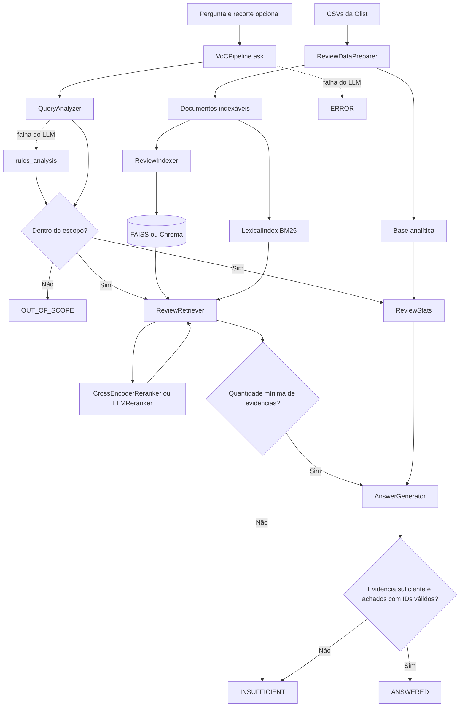

# Classes e funções do Voz do Cliente Olist

A aplicação usa os módulos de `voc_rag/` para preparar as avaliações da Olist e responder às perguntas. `app.py` monta o chat; os notebooks mostram a exploração dos dados e as etapas da busca; `tests/` verifica as regras sem chamar a API.

## Convenções do código

As classes reúnem os dados e as operações de cada componente. Dentro delas, `self` identifica a instância e `__init__` inicializa seus atributos.

| Notação | Uso no projeto |
|---|---|
| `@property` | Acesso como atributo: `settings.analytics_path`, sem parênteses. |
| `@staticmethod` | Método que trabalha com os argumentos da chamada, sem receber `self`. |
| `@classmethod` | Método chamado na classe, como `ReviewFilters.empty()`. |
| `@dataclass` | Geração do construtor e de outros métodos a partir dos campos da classe. |
| `BaseModel` | Definição dos campos e tipos que o Pydantic valida nas entradas estruturadas. |
| Prefixo `_` | Identificação de métodos auxiliares internos. |
| Retorno `None` | Ausência de um valor de resultado; a função pode exibir a tela ou gravar um arquivo. |

## Fluxo de uma consulta

A base analítica inclui as avaliações sem comentário, que continuam contando nas estatísticas. Para a busca, a preparação seleciona os textos que passam no critério de indexação. Com a configuração padrão, uma consulta pode mostrar indicadores de milhares de avaliações e usar até 12 textos distintos (20 em perguntas de panorama) para compor a resposta.

## 1. Configuração: `voc_rag/config.py`

[Abrir arquivo](../voc_rag/config.py)

### Classe `Settings`

Guarda os caminhos dos arquivos, os provedores, os modelos e os parâmetros da busca. A declaração `dataclass(frozen=True)` bloqueia a reatribuição dos campos após a criação. Ao importar o módulo, o código carrega o `.env` e define `ROOT` como a raiz do projeto.

| Atributo | Padrão no código | Finalidade |
|---|---|---|
| `raw_dir`, `processed_dir`, `chroma_dir`, `faiss_dir`, `eval_dir` | pastas em `ROOT / "data"` | CSVs de origem, Parquet preparados, bancos vetoriais e saída da avaliação. |
| `llm_provider` | `LLM_PROVIDER` ou `openai` | Provedor do chat: `openai` ou `google`. |
| `chat_model` | `CHAT_MODEL` ou `gpt-5.6-luna` | Modelo que analisa a pergunta e gera a resposta. |
| `reranker` | `RERANKER` ou `cross_encoder` | `cross_encoder` (local) ou `llm`. |
| `cross_encoder_model` | `CROSS_ENCODER_MODEL` ou `cross-encoder/mmarco-mMiniLMv2-L12-H384-v1` | Cross-encoder multilíngue do rerank local. |
| `rerank_model` | `RERANK_MODEL` ou o `chat_model` | Modelo que dá as notas de relevância com `RERANKER=llm`; use um modelo barato. |
| `judge_provider`, `judge_model` | `JUDGE_PROVIDER` e `JUDGE_MODEL`, ou os do chat | Juiz da avaliação de fundamentação. |
| `temperature` | `LLM_TEMPERATURE` ou `None` | Só é enviada quando definida; modelos de raciocínio recusam o parâmetro. |
| `embedding_provider` | `EMBEDDING_PROVIDER` ou `local` | Provedor dos embeddings: `local`, `openai` ou `google`. |
| `embedding_model` | `EMBEDDING_MODEL` ou o padrão do provedor | `intfloat/multilingual-e5-small` (local), `text-embedding-3-small` (OpenAI) ou `gemini-embedding-2-preview` (Google). |
| `vector_store` | `VECTOR_STORE` ou `faiss` | Banco vetorial: `faiss` ou `chroma`. |
| `min_similarity` | `MIN_SIMILARITY` ou o padrão do provedor | Similaridade de cosseno mínima de um candidato: 0,80 no E5 local e 0,40 nos modelos por API. |
| `use_multi_query`, `use_bm25`, `use_rerank` | `USE_MULTI_QUERY`, `USE_BM25`, `USE_RERANK` ou `true` | Ligam os componentes da busca. |
| `fetch_k`, `lexical_k` | `40` | Candidatos pedidos ao banco vetorial e ao BM25 por frase de busca. |
| `rerank_k` | `30` | Candidatos por frase enviados ao rerank. |
| `rrf_k` | `60` | Constante do Reciprocal Rank Fusion. |
| `min_relevance` | `2` | Nota mínima do rerank por LLM (0 a 3) para uma avaliação virar evidência. |
| `min_rerank_score` | `MIN_RERANK_SCORE` ou `-1.0` | Logit mínimo do cross-encoder para uma avaliação virar evidência. |
| `mmr_lambda` | `0.7` | Peso da relevância no MMR; o restante pesa a diversidade. |
| `top_k`, `overview_top_k` | `12`, `20` | Máximo de evidências em perguntas específicas e de panorama. |
| `min_evidences` | `3` | Mínimo de evidências para chamar o gerador. |

O construtor consulta as variáveis de ambiente ao criar a instância, e `__post_init__` valida `embedding_provider`, `vector_store` e `reranker` e preenche os campos vazios que herdam outro valor. Para alterar um valor em código, passe o campo na chamada, como `Settings(top_k=8)`, ou use `dataclasses.replace(settings, use_rerank=False)`.

#### `Settings.collection_name`

Deriva o nome da coleção do modelo de embeddings, como `olist_reviews_intfloat_multilingual_e5_small`. Cada modelo tem sua própria coleção no Chroma e seus próprios arquivos no FAISS (`faiss_index_path` e `faiss_ids_path`).

#### `Settings.analytics_path` e `Settings.documents_path`

Fornecem os `Path` de `reviews_analytics.parquet` e `reviews_documents.parquet` dentro de `processed_dir`.

### Funções `env_flag(name, default)` e `env_float(name)`

Leem variáveis de ambiente booleanas (`true`, `1`, `sim`) e numéricas opcionais.

## 2. Provedores: `voc_rag/llm.py`

[Abrir arquivo](../voc_rag/llm.py)

### Função `require_api_key(provider)`

Confere se o `.env` tem a chave do provedor (`OPENAI_API_KEY`, ou `GOOGLE_API_KEY`/`GEMINI_API_KEY`) e levanta um erro com a variável que falta.

### Função `create_chat_model(provider, model, temperature=None)`

Cria o modelo de chat com `init_chat_model` do LangChain. Envia `temperature` só quando o valor é informado.

### Função `create_embeddings(settings)`

Devolve `E5Embeddings`, `OpenAIEmbeddings` ou `GoogleGenerativeAIEmbeddings`, conforme `embedding_provider`. No Gemini, a biblioteca usa as tarefas de documento e de consulta em `embed_documents` e `embed_query`.

### Classe `E5Embeddings`

Embeddings locais com `sentence-transformers`. `embed_documents` acrescenta o prefixo `passage: ` e `embed_query`, o prefixo `query: `, como a família E5 exige; os vetores saem normalizados. Outros modelos locais recebem o texto sem prefixo.

## 3. Estruturas de dados: `voc_rag/schemas.py`

[Abrir arquivo](../voc_rag/schemas.py)

### Classe `ReviewFilters`

Define os filtros de uma pergunta: `min_score`, `max_score`, `delivery_status`, `category`, `start_month`, `end_month` e `states`. Os campos não têm valor padrão porque a saída estruturada do LLM exige todos; use `ReviewFilters.empty()` para criar um filtro sem restrições e `model_copy(update=...)` para preencher campos.

`delivery_status` aceita `no_prazo`, `atrasado` ou `nao_entregue`. Os meses usam `AAAA-MM`, e `states` recebe siglas de UF.

#### `ReviewFilters.conditions()`

Converte os campos em uma lista de tuplas `(coluna, operador, valor)`. O banco vetorial, o BM25 e as estatísticas usam essa mesma lista, que a interface exibe como filtros aplicados.

- Inclui os limites de nota quando pertencem ao intervalo de 1 a 5.
- Usa igualdade para categoria e situação de entrega.
- Converte meses válidos para números `AAAAMM` e compara a coluna `purchase_month_num`.
- Normaliza as UFs para maiúsculas, descarta siglas inexistentes e gera `("state", "in", [...])`.

Por exemplo, `max_score=2` e `states=["sp"]` produzem `[('score', '<=', 2), ('state', 'in', ['SP'])]`.

#### `ReviewFilters.merged(override)` e `ReviewFilters.overridden_by(override)`

`merged` devolve um novo filtro em que os campos preenchidos de `override` têm prioridade. `overridden_by` lista os campos que `override` trocou por um valor diferente; o pipeline usa a lista para avisar o usuário.

### Classe `QueryAnalysis`

Guarda a interpretação que `QueryAnalyzer.analyze()` obtém do modelo:

| Campo | Significado |
|---|---|
| `in_scope` | Indica se a pergunta trata da experiência de clientes no e-commerce. |
| `question_type` | `overview` para perguntas de panorama ou `specific` para perguntas pontuais. |
| `search_queries` | Frases escritas como um cliente escreveria, de 1 a 2 em `specific` e de 4 a 6 em `overview`. |
| `filters` | Objeto `ReviewFilters` com as restrições extraídas. |

A propriedade `source` informa se a análise veio do LLM (`llm`) ou das regras de fallback (`rules`); é um atributo privado e não entra no esquema enviado ao modelo.

### Classes `Insight` e `GeneratedAnswer`

`Insight` associa um achado (`text`) aos IDs que o sustentam (`evidence_ids`). `GeneratedAnswer` traz `sufficient_evidence`, `summary`, `insights` e `limitations`. A propriedade `dropped_insights` informa quantos achados a validação de citações descartou; ela é um atributo privado do Pydantic e não entra no esquema enviado ao LLM.

### Classe `Status`

| Membro | Valor | Uso |
|---|---|---|
| `Status.ANSWERED` | `respondida` | Há evidências suficientes e achados com citações válidas. |
| `Status.OUT_OF_SCOPE` | `fora_do_escopo` | A pergunta não pertence ao tema da base. |
| `Status.INSUFFICIENT` | `evidencia_insuficiente` | Faltam evidências ou achados válidos para responder. |
| `Status.ERROR` | `erro` | O LLM ou a busca falharam; o resultado guarda o que já tinha sido recuperado. |

### Classe `Evidence`

| Campo | Significado |
|---|---|
| `id` | Identificador temporário na resposta, como `R1`; não é o `review_id`. |
| `text` | Texto da avaliação. |
| `similarity` | Similaridade de cosseno com a frase de busca. |
| `metadata` | Nota, categoria, entrega, mês, estado e `review_id`. |
| `occurrences` | Quantidade de avaliações com o mesmo texto agrupadas na evidência. |
| `review_id` | ID da avaliação exibida. |
| `matched_query` | Frase de busca que encontrou a avaliação. |
| `dense_rank`, `lexical_rank` | Posição na busca densa e no BM25, ou `None` quando a avaliação não apareceu na lista. |
| `relevance` | Logit do cross-encoder ou nota do LLM (0 a 3), ou `None` com o rerank desligado. |

### Classe `PipelineResult`

Reúne o resultado de `VoCPipeline.ask()`. Além da pergunta, do status, do resumo, dos achados, das limitações, das evidências, da análise e do panorama, guarda:

- `filters`: o filtro efetivamente aplicado, depois da mescla com o recorte manual;
- `notices`: avisos ao usuário, como a substituição de um filtro;
- `trace`: o funil de cada frase de busca, a barreira que recusou (`stopped_at`), os tempos por etapa e os tokens por modelo.

#### `PipelineResult.cited_ids`

Reúne os IDs dos achados em um `set[str]`. A interface usa essa propriedade para marcar as avaliações citadas.

#### `PipelineResult.to_markdown()`

Monta o Markdown com pergunta, estado, frases de busca, filtros, avisos, resumo, achados, limitações e a tabela de evidências com similaridade e relevância. Troca `|` por `/` no texto das avaliações para preservar as colunas.

## 4. Preparação: `voc_rag/preparation.py`

[Abrir arquivo](../voc_rag/preparation.py)

### Função `clean_text(value)`

Limpa um título ou comentário. Para entradas que não são strings, retorna `None`. Normaliza Unicode para NFC, troca quebras de linha e tabulações por espaços, mascara e-mails, URLs, CPFs e telefones (`[email]`, `[url]`, `[cpf]`, `[telefone]`) e reduz sequências de três ou mais sinais iguais de pontuação. Mantém acentos, maiúsculas e palavras como "não". Os limites de palavra no telefone evitam mascarar números curtos, como o de um pedido.

### Função `compose_text(title, comment)`

Junta título e comentário após a limpeza. Se o comentário contém o título, usa só o comentário. Acrescenta um ponto às partes sem pontuação final. Se as duas partes estiverem ausentes, retorna `None`.

### Classe `ReviewDataPreparer`

Lê os CSVs da Olist, combina as tabelas e produz as bases das estatísticas e da busca.

#### `ReviewDataPreparer.run()`

Lê os cinco CSVs de `FILES` em `raw_dir`, chama `build()` e grava `analytics_path` (toda a base) e `documents_path` (as linhas com `indexable=True`). Devolve o relatório de `_report()`.

#### `ReviewDataPreparer.build(tables)`

Combina os DataFrames de `tables` (`reviews`, `orders`, `items`, `products` e `customers`) com junções à esquerda por `order_id`. Preenche categorias ausentes com `sem_categoria` e marca como indexável o texto com pelo menos uma letra e duas palavras.

#### Métodos auxiliares

- `_prepare_reviews(raw)`: remove `review_id` repetidos, limpa e combina título e comentário e devolve `review_id`, `order_id`, `score`, `text` e `has_comment`.
- `_prepare_orders(orders, customers)`: calcula `delay_days`, `delivery_status` (`nao_entregue`, `atrasado` ou `no_prazo`), `purchase_month`, `purchase_month_num` e o `state` do cliente.
- `_main_category(items, products)`: usa a categoria do item de maior preço do pedido.
- `_report(raw, base)`: monta o relatório com contagens, ausências, taxa de comentário por nota e nota 1 por situação de entrega.

## 5. Indexação: `voc_rag/indexing.py` e `voc_rag/vector_store.py`

[Abrir indexing.py](../voc_rag/indexing.py) · [Abrir vector_store.py](../voc_rag/vector_store.py)

### Função `create_vector_store(settings)`

Cria os embeddings e devolve um `FaissReviewStore` (padrão) ou um `ChromaReviewStore`, conforme `vector_store`. Os dois oferecem a mesma interface ao retriever: `embeddings`, `count()`, `search(query_vector, k, filters)` e `fetch(ids)`.

### Função `check_index(store, settings)`

Compara a quantidade de documentos do índice com a do Parquet de documentos e levanta um erro que pede `index` quando elas diferem.

### Classe `ReviewIndexer`

`build()` lê `documents_path` e grava o índice do banco configurado: no FAISS, gera os embeddings de todos os textos e cria um `IndexFlatIP` exato; no Chroma, recria a coleção do modelo e envia lotes de 1.000 documentos.

### Classe `FaissReviewStore`

- `build(settings, embeddings, documents)`: normaliza os vetores, cria o `IndexFlatIP` (produto interno de vetores normalizados, ou seja, cosseno) e grava o índice e a lista de `review_id` em `faiss_dir`.
- `load(settings, embeddings)`: lê o índice e confere se a lista de IDs é a mesma do Parquet de documentos.
- `search(query_vector, k, filters)`: transforma o filtro numa máscara com `filter_mask` e passa as posições permitidas ao `IDSelectorBatch`. O FAISS compara a consulta só com o recorte, então a busca continua exata em recortes pequenos.
- `fetch(ids)`: devolve texto, metadados e vetor de cada ID; o vetor vem de `index.reconstruct`, sem recalcular embeddings.

### Classe `ChromaReviewStore`

Adapta o `langchain_chroma.Chroma` à mesma interface. `to_chroma_filter(filters)` converte `conditions()` para `$gte`, `$lte`, `$eq` e `$in` e devolve `None`, uma condição ou um `$and`. A coleção usa distância de cosseno explícita e guarda o provedor e o modelo nos metadados.

### Função `search_with_similarity(store, query, k, filters=None)`

Busca um texto e devolve `(texto, metadados, cosseno)` de cada resultado. O notebook do pipeline usa essa função.

## 6. Interpretação: `voc_rag/query_analyzer.py`

[Abrir arquivo](../voc_rag/query_analyzer.py)

### Classe `QueryAnalyzer`

#### `QueryAnalyzer.__init__(llm, categories)`

Monta o prompt com `ANALYZER_SYSTEM` e a lista de categorias e configura o `llm` para devolver um `QueryAnalysis`. Com `llm=None` (sem chave de API), toda análise usa as regras.

#### `QueryAnalyzer.analyze(question, manual_filters=None)`

Envia a pergunta e, quando houver, o recorte manual descrito por `describe_filters`. Se a chamada falhar, registra um aviso e devolve `rules_analysis`. Depois aproxima a categoria da grafia da base com `CategoryMatcher` (e a anula se nada for parecido), remove frases de busca vazias ou repetidas, limita a lista a `MAX_SEARCH_QUERIES=6` e usa a própria pergunta se não sobrar nenhuma frase.

### Classe `CategoryMatcher`

Normaliza nomes de categoria (minúsculas, sem acentos, sem pontuação e sem conectivos como "e" e "de") e usa `difflib.get_close_matches` com corte de 0,75: "cama, mesa e banho" e "Cama Mesa Banho" viram `cama_mesa_banho`. `find_in(text)` procura a categoria mais longa citada num texto.

### Função `rules_analysis(question, categories)`

Fallback determinístico. Marca a pergunta como dentro do escopo, já que as regras não verificam escopo, e:

- "nota baixa" e "insatisfeitos" viram `max_score=2`; "nota alta", "elogios" e "satisfeitos" viram `min_score=4`; "reclamações" e "problemas" só trocam os subtemas, sem filtro de nota, como no prompt do LLM;
- "principais", "padrões" e "recorrentes" marcam a pergunta como panorama e usam os subtemas `NEGATIVE_TOPICS` ou `POSITIVE_TOPICS` como frases de busca; nas outras, a própria pergunta é a frase;
- lê mês e ano ("novembro de 2017", "em 2018"), situação de entrega ("pedidos entregues com atraso", "não chegou"), categoria e estados (siglas e nomes por extenso).

## 7. Busca lexical: `voc_rag/lexical.py`

[Abrir arquivo](../voc_rag/lexical.py)

### Funções `strip_accents(text)` e `tokenize(text)`

`tokenize` passa o texto para minúsculas, tira os acentos, remove stopwords e corta cada palavra em 5 letras, o que aproxima variações da mesma raiz: entrega, entregue e entregaram viram `entre`. "Não" fica fora das stopwords, porque "não chegou" e "chegou" pedem avaliações opostas.

### Classe `LexicalIndex`

#### `LexicalIndex.__init__(documents)`

Monta o índice BM25 (`rank_bm25.BM25Okapi`) em memória sobre o texto dos documentos.

#### `LexicalIndex.search(query, filters, k)`

Pontua os documentos, zera a pontuação de quem está fora de `filter_mask` e devolve os `review_id` das `k` maiores pontuações positivas.

## 8. Rerank: `voc_rag/reranker.py`

[Abrir arquivo](../voc_rag/reranker.py)

Os dois rerankers têm a mesma interface: `grade(question, filters, queries, texts)` devolve, para cada frase, a relevância de cada candidato; `min_score` é o corte; `score(relevance, similarity)` dá a escala usada pelo MMR. `create_reranker(settings)` escolhe a classe conforme `settings.reranker`.

### Classe `CrossEncoderReranker`

Usa o cross-encoder `mmarco-mMiniLMv2-L12-H384-v1`, que lê a frase de busca e a avaliação juntas. Envia todos os pares de todas as frases num único lote e devolve logits contínuos. O corte vem de `settings.min_rerank_score` (−1 por padrão), e o `score` usado pelo MMR é a sigmoide do logit. É determinístico e não custa nada por consulta.

### Classes `Grade` e `RelevanceGrades`

Esquema da saída estruturada do rerank por LLM: uma nota de 0 a 3 para cada ID de candidato (`C1`, `C2`…).

### Classe `LLMReranker`

Faz uma chamada por frase de busca, todas em paralelo com `chain.batch`. Cada chamada recebe a pergunta original, a descrição do filtro aplicado, a frase de busca e os candidatos numerados. IDs ausentes ou inválidos ficam com nota 0, e notas fora de 0 a 3 são limitadas a esse intervalo. O corte é `min_relevance=2`, e o `score` vale `(nota + similaridade) / 4`: a nota domina e a similaridade desempata.

## 9. Recuperação: `voc_rag/retriever.py`

[Abrir arquivo](../voc_rag/retriever.py)

### Funções auxiliares

- `describe_filters(filters)`: descreve as condições em texto, ou "nenhum".
- `reciprocal_rank_fusion(rankings, k)`: soma `1 / (k + posição)` de cada lista e ordena pela soma.
- `text_key(text)`: normaliza o texto para agrupar repetidos (minúsculas, espaços e pontuação final).
- `normalize(vectors)`: divide os vetores pela norma.
- `maximal_marginal_relevance(relevance, vectors, k, weight)`: escolhe `k` itens equilibrando relevância e redundância.

### Classes `Candidate` e `Retrieval`

`Candidate` guarda um candidato com texto, metadados, vetor, similaridade, frase de busca, posições nas buscas e nota do rerank. A propriedade `score` alimenta o MMR: com rerank, vale o `score` do reranker (sigmoide do logit ou `(nota + similaridade) / 4`); sem rerank, vale a similaridade. `Retrieval` reúne as evidências e o funil.

### Classe `ReviewRetriever`

#### `ReviewRetriever.__init__(vector_store, settings, lexical=None, reranker=None)`

Recebe o banco vetorial (`FaissReviewStore` ou `ChromaReviewStore`), as configurações e, opcionalmente, o `LexicalIndex` e o reranker.

#### `ReviewRetriever.rank(question, queries, filters)`

Para cada frase de busca, `_candidates`:

1. gera o embedding da frase e busca `fetch_k` documentos no banco vetorial com o filtro;
2. busca `lexical_k` documentos no BM25, quando ligado, e funde as listas por RRF;
3. lê os vetores dos candidatos no índice (`fetch`) e calcula o cosseno com a frase, o que também vale para os candidatos que vieram só do BM25;
4. descarta candidatos abaixo de `min_similarity`.

Com o rerank ligado, envia até `rerank_k` candidatos por frase ao reranker, mantém os com relevância `>= reranker.min_score` e ordena por relevância, preservando a ordem da fusão nos empates. Devolve as listas por frase e o funil (`dense`, `lexical`, `fused`, `above_similarity`, `best_similarity`, `relevant` e `best_relevance`).

#### `ReviewRetriever.retrieve(question, queries, filters, top_k, on_progress=None)`

Chama `rank` e `_select` e acrescenta ao funil quantas evidências cada frase forneceu (`selected`). Quando recebe `on_progress`, `rank` avisa a etapa `candidates` antes de chamar o rerank.

#### `ReviewRetriever._select(pools, top_k)`

Divide as `top_k` vagas igualmente entre as frases com candidatos; a sobra da divisão vai para as primeiras frases, então 20 vagas para 6 frases viram 4, 4, 3, 3, 3 e 3. Em cada frase, agrupa textos idênticos, conta os `review_id` agrupados em `occurrences`, ignora textos já escolhidos por outra frase e aplica o MMR. Numera as evidências como `R1`, `R2` e assim por diante. `occurrences` não permite estimar a frequência do texto na base inteira.

## 10. Estatísticas: `voc_rag/stats.py`

[Abrir arquivo](../voc_rag/stats.py)

### Função `filter_mask(frame, filters)`

Devolve uma série booleana com as linhas que atendem a todas as condições de `filters`. Valores ausentes contam como fora do recorte. O panorama e o BM25 usam essa função.

### Classe `ReviewStats`

- `categories` e `months`: listas ordenadas das categorias e dos meses de compra da base analítica.
- `count(filters)`: quantidade de avaliações da base analítica no recorte; o pipeline usa o zero para recusar antes da busca.
- `describe(filters)`: devolve o total de avaliações do recorte, a proporção com comentário, as distribuições de nota e de situação de entrega e, quando não há filtro de estado, os cinco estados com mais avaliações. Para um recorte vazio, devolve "Nenhuma avaliação corresponde aos filtros."

### Rótulos: `voc_rag/labels.py`

[Abrir arquivo](../voc_rag/labels.py)

Guarda os rótulos em português usados na interface e nas mensagens: `DELIVERY_LABELS`, `FILTER_LABELS` e `OPERATOR_LABELS`.

- `format_condition(column, operator, value)`: escreve uma condição de `conditions()` com rótulos, como "Mês da compra >= 2017-11" ou "Estado em RJ, SP".
- `describe_conditions(filters)`: junta as condições com ponto e vírgula, ou devolve "toda a base".

## 11. Geração: `voc_rag/generator.py`

[Abrir arquivo](../voc_rag/generator.py)

### Funções `parse_citations(raw)` e `clean_citations(raw_ids, valid_ids)`

`parse_citations` aceita `R3`, `[r3]`, `R 3`, `R1, R4` e intervalos como `R1-R3`, `R1 a R3` e `R1 até R3`. Intervalos com mais de `MAX_CITATION_RANGE=50` IDs são ignorados. `clean_citations` mantém só os IDs presentes na consulta, sem repetição e na ordem citada.

### Função `format_context(evidences)`

Monta um bloco por evidência com o ID, os metadados do pedido (identificados como dados da base, não fala do cliente), a contagem de repetições, a frase de busca que a encontrou e o texto do cliente.

### Classe `AnswerGenerator`

#### `AnswerGenerator.generate(question, evidences, overview)`

Envia ao modelo a pergunta, o panorama e o contexto. Com `llm=None`, a propriedade `available` é falsa e o pipeline não chama o gerador. Depois limpa as citações de cada achado, descarta achados sem citação válida e registra quantos foram descartados em `dropped_insights`. O código confere que os IDs existem, mas não verifica se o texto citado comprova a afirmação; essa conferência é feita na avaliação, pelo juiz.

## 12. Orquestração: `voc_rag/pipeline.py`

[Abrir arquivo](../voc_rag/pipeline.py)

### Função `refusal_gate(query_traces)`

Diz qual barreira recusou uma pergunta com poucas evidências, quando o recorte tinha avaliações: `similarity` (nenhum candidato passou do corte), `rerank` (o rerank descartou os candidatos) ou `min_evidences`.

### Classe `VoCPipeline`

#### `VoCPipeline.__init__(analyzer, retriever, generator, stats, settings)`

Recebe os componentes prontos, o que permite substituí-los nos testes e na avaliação.

#### `VoCPipeline.ask(question, manual_filters=None, use_filters=True, on_progress=None)`

Processa a pergunta e devolve um `PipelineResult`, registrando os tokens de cada modelo e o tempo total no `trace`. O `on_progress` opcional, do tipo `ProgressCallback`, recebe o nome de cada etapa concluída e os dados dela: `analyzed` (tipo da pergunta, frases de busca e filtro), `candidates` (total de candidatos e se o rerank vem a seguir, enviado pelo retriever) e `retrieved` (evidências selecionadas e se bastam para responder). A interface usa esses eventos para mostrar o progresso.

1. Interpreta a pergunta com `analyzer.analyze()`, enviando o recorte manual. Se o LLM falhar, o analisador usa as regras; o pipeline registra `analysis_source` no `trace` e acrescenta `RULES_NOTICE` aos avisos. Só uma exceção do próprio analisador devolve `ERROR`.
2. Se estiver fora do escopo, devolve `OUT_OF_SCOPE` sem buscar.
3. Monta o filtro aplicado: vazio com `use_filters=False`, ou a mescla do filtro da pergunta com o recorte manual, com aviso quando há substituição.
4. Usa todas as frases de busca com `use_multi_query` ligado, ou só a primeira, e `overview_top_k` vagas em perguntas de panorama.
5. Se nenhuma avaliação da base atende ao filtro, como um ano fora do período da base, devolve `INSUFFICIENT` com `EMPTY_FILTER_MESSAGE`, que descreve o recorte e o período coberto, e registra a barreira `empty_filter`, sem buscar.
6. Recupera as evidências e calcula o panorama com o mesmo filtro.
7. Com menos de `min_evidences`, devolve `INSUFFICIENT` sem chamar o gerador e registra a barreira.
8. Sem LLM disponível, devolve `ERROR` com `GENERATION_UNAVAILABLE_MESSAGE`, as evidências e o panorama, e registra a barreira `no_llm`. Caso contrário, chama o gerador. Se ele indicar insuficiência ou não sobrarem achados com citações válidas, devolve `INSUFFICIENT` com as limitações.
9. Caso contrário, devolve `ANSWERED`.

Falhas na busca ou na geração também devolvem `ERROR`, mantendo a análise e as evidências já obtidas.

### Função `build_pipeline(settings=None)`

Cria o modelo de chat (ou segue sem ele, com um aviso, quando falta a chave de API), lê a base analítica, conecta o banco vetorial e confere o índice, monta o `LexicalIndex` e o reranker de `create_reranker` conforme as chaves de `Settings` e devolve o pipeline.

## 13. Avaliação: `voc_rag/evaluation.py`

[Abrir arquivo](../voc_rag/evaluation.py)

### Constantes `PIPELINE_CONFIGS` e `RETRIEVAL_CONFIGS`

As configurações da ablação. `baseline` usa uma frase de busca, busca densa e corte de similaridade; `multi_query`, `hybrid` e `full` acrescentam, em ordem, as frases múltiplas, o BM25 e o rerank. Na recuperação, `dense`, `hybrid`, `dense_rerank` e `hybrid_rerank` comparam só o ranking.

### Classe `CachedAnalyzer`

Guarda a análise de cada pergunta e seus tokens, para que todas as configurações recebam a mesma análise em cada repetição.

### Classe `EvaluationRunner`

- `evaluate_retrieval(themes)`: calcula a precisão@10 de cada tema nas quatro configurações de ranking, sem corte de similaridade e sem o corte do reranker.
- `evaluate_questions(questions, configs, repeat)`: roda as perguntas em cada configuração e repetição e registra status, acerto, barreira, evidências, filtros, tokens e tempo.
- `judge_result(result)`: pede ao juiz um veredito por achado (`sim`, `parcial` ou `nao`) e se o achado atribui ao cliente algo que só está nos metadados.

### Funções `summarize(records, configs)`, `to_markdown(report)` e `run_evaluation(...)`

`summarize` agrega acurácia por split (média e desvio entre repetições), recusas e respostas indevidas, erros, barreiras, vereditos, insights descartados, tokens e tempo. `to_markdown` gera `docs/avaliacao.md`. `run_evaluation` carrega `examples/eval_set.json`, avisa quando o juiz usa o mesmo provedor do gerador e grava o Markdown e `data/eval/avaliacao.json`.

## 14. Interface: `app.py`

[Abrir arquivo](../app.py)

As funções de `app.py` montam o chat no Streamlit. No início do arquivo ficam a configuração da página, os estilos, os rótulos e os caminhos dos avatares.

| Função | Papel |
|---|---|
| `get_pipeline()` | Monta o pipeline uma vez com `@st.cache_resource`. |
| `base_summary()` | Lê os indicadores da tela inicial do Parquet analítico, com cache de 60 segundos. |
| `filter_options()` | Lê as categorias, os meses e os estados para os campos do recorte. |
| `plural(count, singular, plural_form)` | Escolhe a forma da palavra conforme a contagem. |
| `AnalysisProgress` | Recebe os eventos de `on_progress` e atualiza o `st.status` da análise em andamento: escreve as frases de busca, o recorte, os candidatos e as evidências e troca o título pela etapa atual. |
| `render_filters(busy)` | Mostra a chave "Usar filtros de metadados" e os campos de nota, entrega, categoria, mês e estado; durante a análise, avisa que o recorte está travado. Devolve o `ReviewFilters` manual (ou `None`) e a chave. |
| `evidence_table(result)` | Monta a tabela de avaliações com citação, nota, estado, categoria, entrega, mês, repetições, similaridade, relevância e frase de busca. |
| `render(result, index)` | Mostra avisos, resposta ou recusa e as abas "Avaliações", "Panorama do recorte" e "Como chegamos à resposta", esta com filtros, frases de busca, funil, tempo e tokens. |
| `render_sidebar(examples, busy)` | Monta a barra lateral com nova conversa, exemplos e recorte; devolve a pergunta escolhida, o recorte e a chave de filtros. |
| `render_welcome(examples)` | Mostra os indicadores e os cartões iniciais, que usam os exemplos `0`, `1` e `2`. |
| `main()` | Controla a sessão (`history`, `pending_question`, `failed_question`) e chama `ask(pergunta, recorte, usar_filtros, on_progress=...)` dentro de um `st.status`, que fecha como "Análise concluída em N s" ou como erro. A tela inicial fica em um espaço fixo (`st.empty()`) que permanece vazio durante a análise; sem isso, o Streamlit manteria os cartões da execução anterior esmaecidos na tela até a resposta chegar. Um resultado `ERROR` segue o caminho da falha e oferece "Tentar novamente". |

## 15. Linha de comando: `voc_rag/cli.py`

[Abrir arquivo](../voc_rag/cli.py)

| Comando | Ação |
|---|---|
| `prepare` | Executa `ReviewDataPreparer.run()` e imprime o relatório. |
| `index` | Executa `ReviewIndexer.build()` e imprime a quantidade indexada e a coleção. |
| `ask "pergunta"` | Executa `VoCPipeline.ask()` e imprime o Markdown. |
| `examples` | Executa `run_examples()`, que roda `examples/questions.json`, confere `expected_status` e `expected_filters` e grava `docs/exemplos.md`. |
| `evaluate` | Executa `run_evaluation()` com as opções `--judge`, `--repeat`, `--configs`, `--split` e `--skip-retrieval`. |

## 16. Módulos sem classes ou funções próprias

### `voc_rag/prompts.py`

[Abrir arquivo](../voc_rag/prompts.py)

- `ANALYZER_SYSTEM`: escopo, tipo da pergunta, frases de busca, filtros e recorte manual.
- `GENERATOR_SYSTEM` e `GENERATOR_HUMAN`: respostas em português, citações, separação entre metadados e texto do cliente e limites dos números.
- `RERANK_SYSTEM` e `RERANK_HUMAN`: escala de 0 a 3 e exigência das condições essenciais da pergunta.
- `JUDGE_SYSTEM` e `JUDGE_HUMAN`: auditoria dos achados na avaliação.
- `OUT_OF_SCOPE_MESSAGE`, `INSUFFICIENT_MESSAGE`, `EMPTY_FILTER_MESSAGE` e `ERROR_MESSAGE`: respostas padronizadas.
- `FILTER_FIELD_LABELS` e `OVERRIDE_NOTICE`: aviso de substituição de filtro.

### `voc_rag/__init__.py`

O arquivo está vazio e marca `voc_rag` como um pacote Python.

## 17. Testes: `tests/`

[Abrir pasta](../tests/)

Rode `python -m unittest discover -s tests -v`. Os testes não chamam a API: `tests/fakes.py` imita o banco vetorial, o BM25 e o rerank, e os testes do FAISS usam um índice real com vetores sintéticos, e os testes do pipeline usam dublês do analisador e do gerador. Eles cobrem filtros e mescla, pré-filtro e `reconstruct` do FAISS, prefixos do E5, lote do cross-encoder, fallback por regras e correspondência de categorias, limpeza e montagem da base com tabelas sintéticas, citações, agrupamento de repetidos, cota por frase, BM25, rerank, panorama e as transições de status.

## 18. Funções didáticas dos notebooks

### `01_eda_e_montagem_da_base.ipynb`

[Abrir notebook](../notebooks/01_eda_e_montagem_da_base.ipynb)

- `resumo_colunas(df)`: tabela de inspeção com tipo, nulos, valores distintos e um exemplo por coluna.
- `limpar_texto(valor)` e `compor_texto(titulo, comentario)`: as mesmas regras de `clean_text()` e `compose_text()`, incluindo o mascaramento de e-mail, URL, CPF e telefone. O notebook confere que a tabela montada é igual à de `ReviewDataPreparer.build()`.

### `02_pipeline_rag_passo_a_passo.ipynb`

[Abrir notebook](../notebooks/02_pipeline_rag_passo_a_passo.ipynb)

- `to_document(row)`: a versão de `ReviewIndexer._to_document()` usada na demonstração.
- `results_table(search_results)`: organiza os pares `(documento, distância)` da busca densa em um DataFrame, com a similaridade `1 - distância`. A tabela mostra os resultados anteriores à fusão, ao rerank e à seleção do `ReviewRetriever`.
